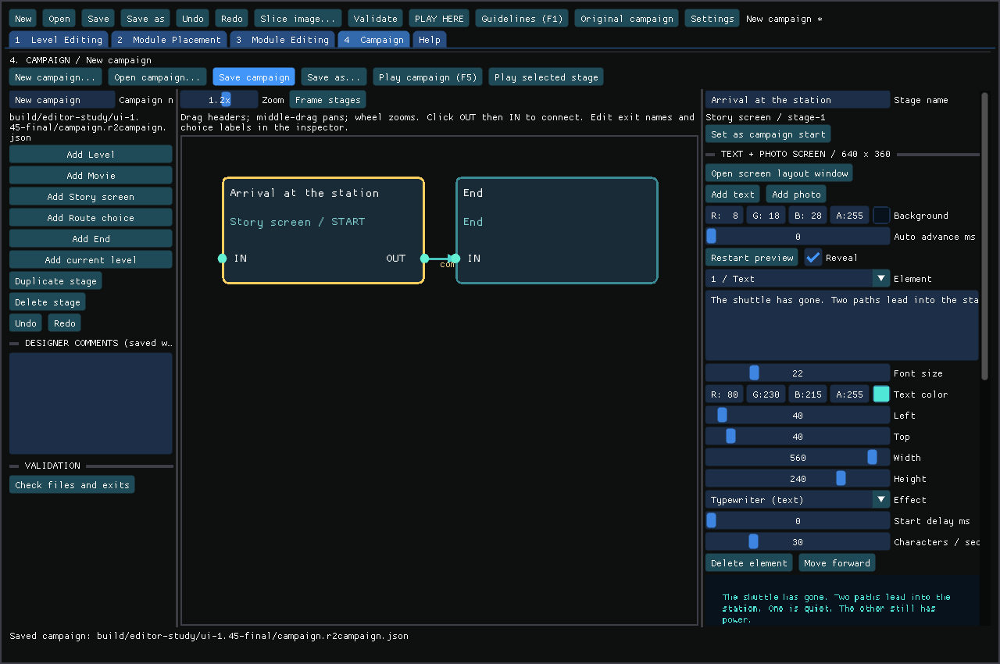
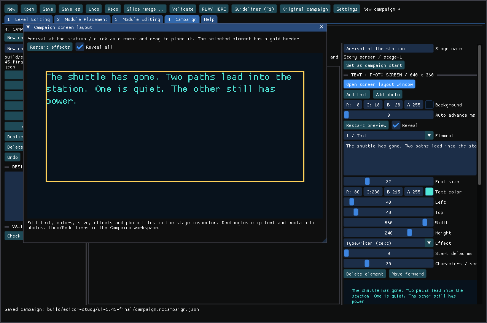

<!-- SPDX-License-Identifier: GPL-3.0-or-later -->
# Campaigns, routes and story screens

The fourth editor workspace connects levels into a playable campaign. It uses a
separate `campaign.r2campaign.json`; each linked level stays an ordinary editable
`.r2project.json`. The other workspaces remain Level Editing, Module Placement and
Module Editing. Help explains the four workflows.

```sh
./edit-local.sh --campaign-editor
```

This opens a private copy of the redistributable Station Routes example. For an
existing document:

```sh
build/package-arm64/reminiscence2-editor --campaign=/path/to/campaign.r2campaign.json --assets=/path/to/assets
build/package-arm64/reminiscence2 --campaign=/path/to/campaign.r2campaign.json --datapath=/path/to/assets
```

When several asset editions are found, the player also needs `--asset-set=dos`,
`amiga`, or the identifier listed by `--list-assets`. Use the edition matching the
imported native levels. Campaigns currently use one selected asset edition per run.

## Build a campaign

1. Choose **4 Campaign**, then **New campaign…**, or open an existing document.
2. Add **Level**, **Movie**, **Story screen**, **Route choice**, or **End** stages.
3. Select a Level stage and **Import / replace level…**. This copies the project
   and referenced artwork under the campaign folder. **Add current level** does
   this for the level currently open in the editor. **Open level in editor** opens
   that imported copy for editing.
4. Set the starting stage. Connect **OUT** to **IN**. Drag headers to arrange the
   graph; middle-drag pans, the wheel zooms, and **Frame stages** fits the graph.
5. In the inspector, name each exit and its destination. Rename, duplicate or delete
   stages as needed. Deleting a stage removes incoming links and clears an affected
   start selection. The document remains an editable draft until you repair it.
6. **Check files and exits**, save, then **Play campaign** (F5). **Play selected
   stage** starts at that stage for testing. Campaign Undo/Redo is separate from
   level Undo/Redo. Command/Ctrl-S saves the active workspace's document.

Several routes with the same exit name offer a player choice, using their **Choice
label**. Different exit names select different paths automatically. For example,
`complete` can lead to the next mission while `secret` leads to a bonus level.
Choice stages offer all their outgoing routes. Loops and revisiting levels are
allowed. Levels retain actors and puzzle state on return by default; the player
arrives at the authored entrance. Disable **Remember world on return** on a Level
stage to reset it each time.

A custom level must have a **Level exit** node. Connect a button, area trigger,
completed objective, defeated enemy or dialogue branch to its **Activate** input.
Set **Exit route** to match the campaign edge. Original native level transitions
emit `complete`; the campaign intercepts the transition before another native
level loads. Native levels can also use explicit Level exit extension nodes.
Standalone `--project` play exits when one of these nodes activates.

New full-native-campaign exports include a seven-level route document and an End
stage. Existing private exports remain intact; import their level files into a new
campaign to arrange your own route. `./edit-local.sh --campaign` still opens the
native campaign level editor; `--campaign-editor` opens the new route example.

## Movies

Movie stages use the existing engine cutscene catalog and decoder, including
original polygon sequences and Sega CD MCD movies with their sound. Use **Read available movies** and the catalog dropdown, or select a
catalog name from `reminiscence2 --list-cutscenes --datapath=…`, for example
`teleport` or Sega CD `sc1`. A multipart polygon selection may use `name:part`.
Missing selections produce an error rather than silently skipping the scene.
Arbitrary MP4 files and upscaled movie replacements are not implemented in this
campaign player.

## Text and photos

Story, Choice and End stages use a **640 × 360** composition canvas, scaled to the
window. Add up to 16 text/photo elements; later elements appear in front.

- Text: editable wording, color/opacity, font size, rectangle, typewriter rate,
  start delay and fade duration. The current font supports ASCII text.
- Photo: import PNG/JPEG/BMP, set its rectangle and optional delayed fade. Photos
  fit inside the rectangle with their original aspect ratio.
- **Open screen layout window** shows a larger preview. Click an element, then
  drag it to position it. Numeric Left/Top/Width/Height controls give exact placement.
- **Restart preview** replays effects; **Reveal** displays the finished screen.
  Preview and playback share the same renderer, wrapping and clipping rules.
- Auto-advance is optional for Story and End stages. Choice stages wait for input.
  Leave room near the bottom for the player controls and any route choices.

In playback, **Enter** reveals effects, then a fresh press continues or confirms;
**Up/Down** selects a route and **Esc** leaves. Story text and photos never alter
original game data. Use artwork and writing you have permission to distribute.

## Boundaries

Campaign progress saves the route, actors, inventory, collision changes, puzzle
nodes, timers, queued native messages, checkpoint and open dialogue in one atomic
file. Living gameplay autosaves every ten seconds, at custom checkpoints, on leaving a level and between
stages. Ctrl+S/Ctrl+L (or mapped quick-save/load controls) save/load that checkpoint.
Native QoL Save/Load and death recovery use the campaign checkpoint too. Custom
scene death uses Enter to restore it. Ordinary game saves stay separate.

Standalone custom playtests also retain a complete in-memory checkpoint, including
doors, timers and named quest items. Death/restart returns to that state; before
the first checkpoint it restarts the project. Stop and Play creates a fresh test.
Disconnecting a controller pauses custom actors and node timers. Reconnect or use
the keyboard, then press Enter/confirm once to resume; this press does not operate
a nearby switch. Timed story screens pause when the app loses focus.

The launcher offers **Resume campaign** or **New campaign** when progress exists.
Use `--campaign-resume` / `--campaign-new` explicitly; editor **Play campaign** starts
a new run and **Resume campaign** restores it. Selected-stage tests have their own
save. Files live in the player's `--savepath/campaigns` directory. Campaign and
level-definition changes reject an incompatible resume before restoring gameplay;
start a new run after changing the design. Malformed saves leave current state
untouched. Story screens and movies resume at their beginning; completed stages
waiting for a route choice do not replay their level/movie.

Give Item / pickup, Dialogue NPC and Has item? nodes the same **Campaign key** to
carry and consume items across modules and levels. **Set campaign flag** and
**Test campaign flag** share named booleans. Route **Required flag** fields filter
choices, with either true or false required. Keep an unconditional route available
when a condition may hide the others. Carry health/native inventory can be disabled
in the campaign inspector. Native inventory moves only into a unique matching
item template already present in the destination level; unavailable or ambiguous
templates remain in the campaign inventory for a later compatible stage. It never
copies raw actor IDs or imports foreign script dependencies. Standalone native
playtest saves remain in the imported level's private preview-save directory.
Native original scripts/cinematics still run within each level, so account for
those when inserting an additional movie stage.

Draft campaigns can be saved with unfinished links. Play validates every linked
level, image, exit and destination first. Native projects must match their source
edition and asset fingerprint. No original game assets are included in the public
example. Copy the **whole campaign folder** when relocating or sharing a campaign;
Save As keeps the existing asset root.

## Developer contract

`editor/campaign.h/.cpp` defines schema **2** (schema 1 migrates with persistence enabled). Limits: 128 stages, 8 routes per
stage, 16 elements per screen and a 2 MiB document. `entry` and route `to` refer to
stable stage IDs. Kinds are Level=0, Movie=1, Story=2, Choice=3, End=4. Routes contain
`key`, `label`, `to`, optional `condition` and `requires` (true by default); ordinary presentations emit `complete`. Stage `level` paths
and photo `file` paths are relative to the campaign directory and cannot escape
it. Graph positions are integers in 0..8192.

Story elements contain `kind` (Text=0, Photo=1), `text`/`file`, `x`, `y`, `width`,
`height`, font `size` (8..64), RGBA `color`, `effect` (None=0, Typewriter=1, Fade=2),
`delay`/`duration` in milliseconds and `rate` in characters/second. Stage
`background` is RGBA; `advance=0` waits for input. Rectangles stay inside 640×360.
Text is clipped to its rectangle; typewriter reveal preserves the full text's
layout. Stage/campaign `comments` are designer notes.

`campaign_player.cpp` composes and runs presentation stages. `Scene::exitRoute()`
returns authored exits; `AuthoringHooks::levelExit` intercepts original native
transitions/final completion. A native stage returns to the campaign router before
loading a sibling. The ordinary native project runner keeps its previous sibling
behavior. Route cycles are intentional, with a 4096-stage navigation budget.

Regression coverage includes serialization, unsafe paths/numbers, missing exits,
loops/forks, text/fade/photo rendering, real UI connections/save/help windows,
gameplay health/teleport/checkpoint/exit nodes, and real SDL campaign playback
through story, custom level, original movie/audio and ending on all three asset
editions.

## Editor captures





## Progress document and robustness

`.r2save.json` schema 1 is bounded to 32 MiB, 128 level snapshots and 4096 shared
values. It records `identity` (content hash of campaign plus referenced level
projects), `edition`, `stage`, pending `exit`, `finished`, `visits`, `health`,
`values`, `inventory` and `levels`. Save filenames hash the campaign location
and optional test stage; payloads contain no absolute asset/project paths.
FNV identity is a compatibility check, not a security signature.

Each level snapshot (maximum 2 MiB) contains the validated native save payload as
hex plus graph/dialogue/timer/message state. Runtime pointers are never serialized.
The existing resource-aware native save validator checks actor links, scripts,
animations and asset fingerprint before decoding. All graph indices, lengths and
integer bounds and dialogue-queue consistency are checked before mutating the
running scene. Optional `localValues` stores standalone `item:`/`flag:` booleans;
older snapshots without it remain readable, while campaign-owned values stay in
the outer progress document. Writes use the
engine's atomic-file helper; failed writes retain the previous file. Presentation
stage effects restart on resume. There is one campaign checkpoint, not manual
slot names or a rewind history.

`Stage.remember` controls world reuse. `Campaign.carryInventory` and
`Campaign.carryHealth` default to true. Named authored items/flags are always shared
within a campaign. A level revisited from a route resets only the player's entry
state and re-arms Level exit nodes; puzzle completion, collected pickups and other
actors remain as saved. Direct resume restores the saved player position instead.

## Story motion and black fades (1.48)

Expand **Motion** in a story element to set signed horizontal/vertical travel and
travel time. Movement starts after the element's delay and is independent of text
reveal. Photos keep their aspect ratio; transparent sprites composite over earlier
layers. Set **Auto advance ms** and **Fade to black ms** on the stage to fade the
entire presentation, captions included, before continuing. Timed, single-route
screens hide the control footer; Enter still reveals/skips, and Escape leaves.

These are optional schema-2 fields. Story elements add `moveX` (-1280..1280,
default 0), `moveY` (-720..720, default 0), `moveDuration` (1..600000 ms, default
1000). Translation is linear, clamps at its endpoint and clips to the canvas.
Starting rectangles retain their existing bounds. Stage `fadeOut` defaults to 0
and must be between 0 and `advance` on a timed screen with at most one route
(choices cannot fade away); it covers the last `fadeOut` milliseconds.
The exact end frame is black even after text reveal. Older campaigns retain their
previous rendering. Older players ignore these optional presentation additions;
use 1.48 or later for the authored motion and finale.

For a launch or ending, create separate story stages and connect them to the
level's exit route. Cinematic artwork is a separate campaign dependency from
level scenery; keep both beside the campaign when sharing your own project.
