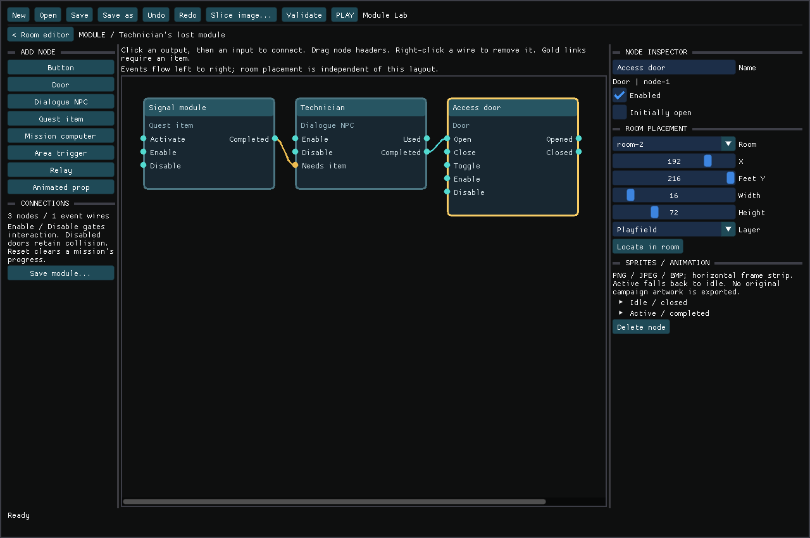
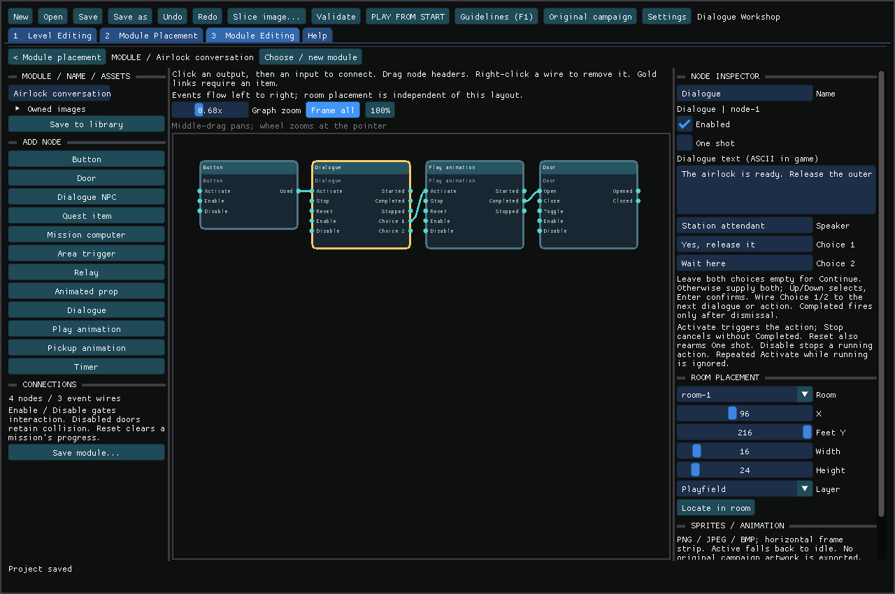
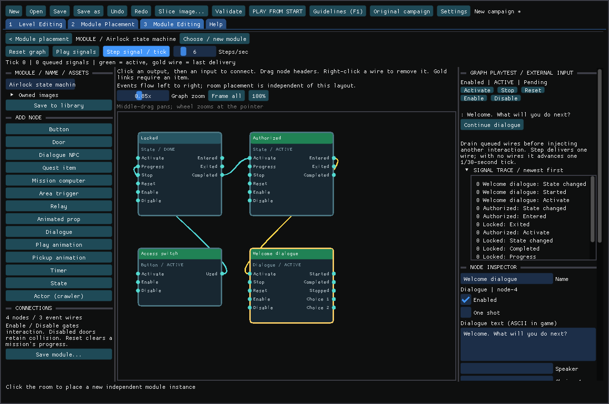

<!-- SPDX-License-Identifier: GPL-3.0-or-later -->
# Visual interactable modules

Version 1.44 adds [complete native campaign modules](NATIVE_CAMPAIGN_MODULES.md),
including typed connections, private behaviors, safe bundle copies and message tracing.
Version 1.43 added state machines, node playback and native event bindings to the
three workspaces introduced in 1.42. That version separates level authoring, module placement and module editing, and
adds dialogue/action nodes and a local module library. Each placed
module owns its nodes, connections, state and artwork references. A duplicate
keeps the internal wiring but starts with its own inventory, objectives and doors.

## Four workspaces and Help

| Top tab | Work done here |
| --- | --- |
| **1 Level Editing** | Import/slice Back, Playfield and Front art; paint collision and ledges; define exits and player start. Modules stay visible for reference. |
| **2 Module Placement** | Pick a whole puzzle from recipes or the local library; place, select, move and duplicate instances and their parts. |
| **3 Module Editing** | Create a named module; import its image assets; add individual behavior nodes and connect signals to actions. |
| **4 Campaign** | Link levels, movies, illustrated story screens, route choices and endings in a separate campaign document. |
| **Help** | Workflow instructions, node semantics, pixel dimensions, visual-style guidelines, shortcuts and native campaign limits. F1 also opens help during play. |

The first three tabs share one level project and undo history. Campaign has its own document and history. Switching tabs cancels unfinished
placement/drag/wire gestures. Room tools cannot accidentally drag or delete a
selected puzzle. Module Placement does not paint collision or edit room art.

The toolbar identifies the active level or campaign and shows **Saved** or
**Unsaved changes**. New/Open, Save/Save as, Undo/Redo, Validate and Play act on
that workspace's document. Campaign edits have their own undo history. Actions
wrap at smaller window sizes. The **Tips** checkbox hides or shows a short guide
for the current workspace; hover controls for explanations and shortcuts.

Use **Game assets…** from any workspace to choose extracted game files. Editing
and **Start graph / Play signals** work without them; gameplay needs a supported
edition. **Start…** beside Play offers the current room/TEST marker or authored
start explicitly, plus the default-start setting. Escape leaves room painting or
module placement mode, and cancels the file picker.

In Module Editing, **Find a node or action…** searches names, categories and
behavior descriptions. For example, `collects` finds pickups and `paginated`
finds dialogue. The category selector narrows the list to gameplay, inventory,
story, logic, presentation or audio. **Clear node filters** restores all nodes.
Hover a node for its behavior summary; its help window explains every port.

## One connected puzzle per module

The module is the complete puzzle. Its nodes are the individual switches, doors,
items, NPCs, mission computers and other parts. Connections express the puzzle's
signals and requirements. Parts may occupy different rooms while belonging to
one module; they should not be grouped merely because they share a room.

A module owns its local items, objective counters, flags and door state. Whole-
module selection, duplication and prefab saving preserve its internal wiring;
new instances have independent state and identities. Shared systems such as
Conrad, the native inventory and campaign progression are outside puzzle ownership.

Native campaigns now expose their full rule tables and group reviewed actor
dependencies into puzzle modules. These groups preserve original IDs; they are
editable in place and copyable as complete dependency bundles within their source
level and edition, subject to native capacity/resource limits. Actor bindings bridge
native rule execution and messages to authored graphs. The [native puzzle design contract](LEVEL_EDITOR_DESIGN.md#native-puzzles-as-connected-modules)
describes the agreed boundary and validation requirements for that work.

## Try it

```sh
./edit-local.sh --modules
```

This creates a private copy of **Module Lab** under
`.local/editor-projects/ModuleLab`. Press PLAY to try three rooms: a switch/door,
a technician retrieving an item, and a mission terminal that unlocks an exit.
The supplied dialogue and schematic graphics are newly authored, not copied from
Flashback. Play requires your prepared Amiga, DOS/GOG or Sega CD game files.

In **2 Module Placement**, select a part in the room and press **EDIT MODULE GRAPH**. Existing paired doors
also have **Convert to node graph**, retaining their part positions, starting
state, toggle behavior and legacy chain connections. Undo reverses conversion.



## Build a module

1. Open **3 Module Editing**, enter a name and click **Create module**. Or choose
   a **Puzzle Modules** template in **2 Module Placement** and click the room.
   Recipes include doors, retrieval quests, mission computers, branching dialogue
   and pickup effects. An entire connected puzzle is one module.
2. Open its graph. Add nodes from the left palette. Drag a node's header to
   arrange the diagram; this does not move its part in the level.
3. Click a turquoise output circle, then an input circle. For example,
   **Button: Used → Door: Open**, or **Computer: Completed → Door: Open**.
   A button can use Toggle instead of Open. Right-click a wire to remove it.
   Cancel an unfinished link with Escape or **Cancel link**.
4. Select a node and edit its room, X, feet Y, dimensions and drawing layer.
   **Locate in room** returns to its location. You can drag individual parts in
   the room, including a door and its remote switch in different rooms.
5. Assign idle and active/completed sprites in the inspector. Import PNG, JPEG
   or BMP, choose crop/frame dimensions, frame count and FPS. Frames run
   horizontally. **Loop animation** can be disabled to hold the last frame;
   door-opening clips default to this behavior. PNG alpha supplies transparency.
6. Validate, Save and Play. Enter operates nearby interactables. Quest items are
   collected by proximity. Dialogue pauses actor movement and uses fresh Enter
   presses to advance pages. Holding Enter never skips the whole conversation.

Each node's two sprite states are independent. No sheet means a colored schematic.
An empty active sheet falls back to idle; provide an opening/open sheet if a
custom door should visibly disappear. Sprite pixels do not define collision.
Only door nodes add blocking cells; their X/width use 16-pixel columns and their
feet/height use the original 72-pixel standing geometry.

Dialogue is authored as UTF-8 in the editor, but the native game font currently
renders printable ASCII; other bytes display as `?`. Long passages wrap and
paginate rather than being discarded. The NPC node supports before/after text;
standalone Dialogue nodes provide branching choices. Pickups show a brief top notice.

## Node behaviors and ports

All nodes accept **Enable** and **Disable**. Disabling prevents interaction and
new actions; it does not remove a door's existing collision or hide its artwork.
Relays and area-trigger markers are hidden in gameplay.

| Node | Outputs | Additional inputs / behavior |
| --- | --- | --- |
| Button | Used | Activate; Enter nearby; optional one-shot |
| Door | Opened, Closed | Open, Close, Toggle; events only on a successful state change; closing is refused if Conrad or a live enemy occupies the panel |
| Dialogue NPC / reader | Used, Completed | Enter nearby shows text. An optional required item gates completion. Completion fires once; repeat conversation uses the finished text |
| Quest item | Completed | Activate grants it remotely, or walking nearby collects it; collected once per playtest |
| Mission computer | Used, Completed | Activate accepts the job; Progress counts distinct source nodes; Reset clears acceptance, completion and progress |
| Area trigger | Entered, Exited | Emits once on each overlap edge, including leaving the room. One-shot allows only the first entry/exit pair; disable it for proximity doors. Disabled triggers emit neither event. |
| Relay | Used | Activate forwards a signal; optional one-shot |
| Animated prop | None | Animation and drawing layer only |
| Dialogue | Started, Completed, Stopped, Choice 1, Choice 2 | Activate starts paginated text; optional two-choice branch; Stop cancels; Reset rearms |
| Play animation | Started, Completed, Stopped | Activate starts active strip; Stop cancels; Reset rearms; looping clips need Stop |
| Pickup animation | Started, Completed, Stopped | Same controls as Play animation; effect visible only while active |
| Timer | Started, Completed, Stopped | Activate starts delay; Stop cancels; Reset rearms |

For an NPC hand-in, drag the item's **Completed** output to the NPC's gold
**Needs item** pin, or choose **Required item** in its inspector. The gold wire
is a persistent requirement, not an immediate event. Collecting the item does
not finish the conversation automatically: approach the NPC and press Enter.
**Consume item on completion** controls whether it remains available for another
NPC in the same module. Deleting a required item leaves a validation error;
it never silently removes a quest's requirement.

For a mission, wire the relevant actions into **Progress**, set **Objectives**,
and wire **Completed** into a door, relay or other action. Repeated presses of
one button count as one objective. Objectives completed before accepting the
job are remembered. Reset only resets that computer; it does not undo doors or
recreate consumed items. Wire other actions explicitly when designing a reset.
A completion can open multiple doors by connecting its output to each receiver.

Event delivery is deterministic and bounded: each wire is delivered at most
once per interaction transaction. Cycles terminate. Distinct player actions
start new transactions, so repeatable buttons and toggles still work.

## Reuse and limits

**Save module...** writes a `.r2module.json` and copies its referenced sprite
and audio files. **Load module...** creates a fresh instance and translates all owned parts
by one delta. Imported parts initially share the destination room; reassign
individual rooms afterwards. Relative part positions and internal event/required-
item connections survive. External legacy chain links are excluded from a prefab.
Save As copies every node's artwork and audio too. Original game assets are never exported.

Limits: 64 nodes and 128 event wires per module, 256 graph nodes per project,
64 modules and 64 rooms. Invalid ports, missing references, invalid image paths,
out-of-range geometry and animation strips extending past their image are
rejected before play. Project schemas 1..8 migrate to schema 9; portable module
bundles use schema 7 and still read schemas 1..6. Existing unconverted module types
remain usable.

Standalone Restart resets graph state. Campaign saves preserve graph state,
inventory and flags. Moving platforms and arbitrary user code remain future work.

## Original Flashback campaign coverage audit

**Native campaign mode preserves the full campaign, while the reusable module
palette covers the families below.** Use Original campaign → Edit full native
campaign to edit fixed original actor slots and run all their existing scripts.
Those actors are not automatically converted into independent graph prefabs.
See [native editing and live-apply controls](LEVEL_EDITOR.md#edit-the-full-native-campaign). The audit checked the
palette construction in `editor/main.cpp`, the reviewed runtime bundles in
`editor/runtime.cpp`, original actor/object handling in `piege.cpp`, and the
private Amiga/DOS/Sega CD level inventories from the editor feasibility probe.
Across those editions level one contains 107 actors referencing 50 behavior
nodes; level two contains 256 actors referencing 111 behavior nodes. Many are
helpers, off-screen state holders or dependencies rather than placeable objects.
Native campaign mode retains all these records. Its palette now supports complete
dependency-bundle copies; the custom-project palette remains a separate set of
authored equivalents and reviewed actor templates.

| Campaign object family | Current editor coverage |
| --- | --- |
| Conrad, pistol, projectile, casing, draw/holster controller | Reviewed original bundle used by Play; automatic dependencies |
| Alien crawler | Native animation and behavior, independently placeable |
| Doors and switches | Editable new equivalents, including toggle/remote/cross-room control; original door/switch sprites are not auto-extracted |
| Quest items, keycard checks, NPC hand-ins | New graph behaviors with custom sprites/text; separate module inventory, not original campaign item scripts |
| Mission/job terminals and action chains | New graph equivalents; original jobs, text, credits and story logic are not imported |
| Animated decorations | Imported image strips; original animation resources are not browsable in the palette |
| Health pickup | New proximity-heal behavior; not a complete original recharge-station implementation |
| Lifts/moving platforms, teleports, shield recharge stations, save terminals, credits/trading, timed campaign jobs, other enemy families and their helpers | Not yet supplied as certified original modules |

### Highlighting, monitoring and editing native events

| Requested capability | Current state |
| --- | --- |
| Select existing native actors/helpers from a palette | Available, retaining fixed original IDs |
| Highlight existing actors in their rooms | Available as numbered markers; Settings can hide them |
| Move actors, edit initial health/facing, edit art/collision/exits | Available, with restart/live-apply rules |
| Inspect native event rules and reviewed dependencies | Available in native Module Editing; hidden helpers may have no room marker |
| Observe fired events, state changes and connections live | Native rule/message traces, actor state inspection, frame stepping and authored graph monitor |
| Edit or reconnect original campaign events using nodes | Native conditions/actions/transitions and typed actor/room ports editable; private behavior copies; opaque operands protected |
| Place or duplicate complete original puzzles from the palette | Complete native bundles within their source level/edition; capacity and bank limits checked |

Original `InitPGE::data[]` values mix actor references, counters and other values.
`piege.cpp` has separate message, inventory, text, credit and collision opcodes;
copying one record cannot safely reproduce its surrounding puzzle. Additional
native imports need reviewed reference relocation and graphics/palette ownership,
as done for the player/crawler, rather than guessing which integers are IDs.
The graph equivalents remain available for custom projects; native mode runs the
original campaign directly with native rule nodes and optional authored extension graphs. Macintosh playtests remain unverified and unavailable.

See the [level editor guide](LEVEL_EDITOR.md) and
[format contract](formats/CUSTOM_PROJECTS.md) for room authoring and serialization.

## Dialogue as connected nodes

Add **Dialogue** from the node palette. Set its speaker and text. Leave both
choice fields empty for a simple conversation, or supply both labels to create
two branches. Connect a button's **Used**, an area trigger's **Entered**, or an
NPC's **Used/Completed** to **Dialogue: Activate**.

For example, one airlock puzzle can contain:

```text
Button.Used -> Greeting.Activate
Greeting.Choice 1 -> Door animation.Activate
Door animation.Completed -> Door.Open
Greeting.Choice 2 -> Farewell.Activate
```

**Enter** advances pages; **Up/Down** selects a choice on the last page, and
**Enter** confirms it. Text wraps to the native 30-character display width.
Speaker names allow 28 bytes, choices 26 each and dialogue text 1024. The native
font displays ASCII; unsupported characters display as `?`.

**Started** fires when activated. **Choice 1/2** and **Completed** fire after the
player finishes reading. Multiple triggered dialogues queue in order. Player
motion pauses during dialogue; action timers and animations continue. **Stop**
cancels active or queued text without firing Completed. **Disable** also stops
it and blocks activation. **Reset** cancels and rearms a one-shot action.
Activating an already running action is ignored. Chaining dialogue nodes creates
longer conversations and branching paths; choices are two per node.

The existing **Dialogue NPC** still handles proximity interaction, item hand-in
and before/after text. To give it a branching conversation, connect its output to
a separate Dialogue node and clear its inline text if you do not need both.
Original campaign dialogue/scripts are not automatically converted into these
custom nodes.

## Animation and timed actions

| Node | Behavior |
| --- | --- |
| **Play animation** | Activate starts the active sprite strip at frame zero. A non-looping clip emits Completed after its full duration and holds its final frame. Looping clips run until Stop. |
| **Pickup animation** | Same timing, but visible only while active. Connect Quest item Completed to Activate for a collectible effect. This is an effect at the node's position; it does not replace Conrad's movement or pickup pose. |
| **Timer** | Activate starts a delay of 1–18,000 ticks at 30 Hz. Emits Completed when due. Useful for delayed doors or stopping another action. |

All three emit **Started**, **Completed**, **Stopped** and accept **Activate**,
**Stop**, **Reset**, **Enable**, **Disable**. One-shot actions can run again after
Reset. Stop never emits Completed. Timers and dialogue are invisible during play;
the editor shows their anchors. Use the active strip when supplied; otherwise
animation uses the idle strip, including its loop setting. Set the crop to one
frame, then frame count and FPS. No imported game files are modified.

## Module assets and local library

In Module Editing, **Owned images → Add image** imports an image into the project.
Each node's sprite state can choose a **Module asset**, crop a frame and set its
animation rate. Direct **Import strip** also registers that image with the module.
A module can own up to 64 images. Removing a library entry keeps existing clip
references and image files intact.

**Save to library** writes the complete puzzle to `modules/<name>-<id>.r2module.json`
and copies its image dependencies beside it. In Module Placement, expand
**LOCAL MODULE LIBRARY**, select a template and click the room. **Refresh** reads
added files; **Import module** accepts a template elsewhere on disk. Share the
JSON and its `art/` directory together, using artwork you may redistribute.
This is a local library, with no online service or downloads.

Library placements get new module IDs and independent puzzle state. Saving a
modified template does not alter existing instances. Portable templates initially
place all parts in one destination room, preserving their offsets and internal
wires; move individual parts to other rooms afterward. If the puzzle would extend
outside the room, placement is rejected without modifying the project. Whole
module copy/paste remains available for copying in-project arrangements.



## State machines and node playback (1.43)

Add **State** nodes and give related states the same **Machine group** name.
One enabled state per group may be **Initial state**. Groups are scoped to the
module, so two placed copies never share state. Different groups can run
concurrently. A group without an initial state waits for Activate.

| Input/output | Meaning |
| --- | --- |
| Activate input | Exit the active sibling, then enter this state. Re-entering the same active state does nothing. |
| Entered output | Start this state's actions, animations, dialogue or timer. |
| Exited output | Stop/cancel actions belonging to the old state. |
| Progress input | Emit Completed once during this visit, only while this state is active. |
| Completed output | Usually connects to the next state's Activate. |
| Stop / Reset | Exit the state. Reset also clears its completion latch. |
| Disable | Exit and prevent future activation until Enable. |

For example: **Access switch Used → Locked Progress → Locked Completed →
Authorized Activate → Authorized Entered → Door Open**. The palette's
**State machine airlock** adds a timer to return to Locked. Door closure still
respects occupied space; a blocked Close does not crush an actor or emit Closed.

**Start graph** enters initial states in an isolated simulation. **Play signals**
advances it at the selected steps/second; **Pause signals** freezes it. **Step
signal / tick** delivers exactly one pending wire. Once the queue is empty,
it advances one tick (1/30 second of simulated time), making timers and animation
completion reproducible. **Reset graph** starts fresh. Any document edit resets
playback rather than applying stale pending node indices to a changed graph.

Select a node in playback to inject an external interaction: Use, area entry,
actor event, action input, or dialogue choice. Inputs are held while previous
connections drain. This tests graph logic without game files; physical collisions,
actor AI, artwork and native messages require a level playtest. Dialogue stays
active until you choose Continue or a branch. Green headers indicate active
nodes; the gold wire is the most recent delivery. The newest-first trace is
bounded to 256 records and its entries focus the relevant node. Feedback loops
are bounded to one delivery per wire per transaction and reported as **Cycle
bounded**, so a missing delay cannot hang the editor.

In an embedded playtest, **Inspect running graph** opens a read-only monitor and
pauses the game initially. Resume or **Step gameplay tick** to observe actual
signals. Native extension graphs have **Monitor running native module**; Pause
native holds the world and Restart applies authored changes. A content revision
check prevents stale live states being shown against edited nodes or wires.



## Enemies and friendly actors

The Actor node defaults to **Native crawler**, which creates an independently owned native crawler in a custom
scene. It preserves native hostile AI and artwork. **Patrol bounds** constrain
it to the authored room and horizontal interval. Friendly mode suspends its
native AI and uses a simple floor-aware walk at 1–4 pixels/tick; it stops at
walls and ledges. This mode also suspends native AI damage reactions. Use a
normal hostile actor when testing the original combat/death behavior.


Choose **Armed guard** in a custom scene to use your own humanoid sprite sheet.
Import a transparent four-column, two-row sheet into **Idle art**, with one frame;
the crop covers the complete sheet and its dimensions divide evenly by 4 and 2.
Cells in reading order are idle, walk A, walk B, aim, fire, hurt, fall and dead.
All poses face left. The renderer mirrors them when facing right and anchors the
lowest opaque pixel to the floor. Set the display width/height (16–64 by 24–72
pixels); these actors render on the Playfield layer.

The guard patrols safe floor, aims for one second, fires and recovers for two
seconds. Solid tiles and closed doors block sight; guards do not shoot between
rooms or floors. Friendly cancels a pending attack. Hold freezes patrol/attacks,
while incoming pistol hits still work. Original, Heavy and Laser use the same
native hit query. Death, hurt and patrol endpoints drive existing graph outputs.
Saves preserve attack/animation phases; pause and dialogue suspend combat.
The engine supplies behavior only: import artwork you are entitled to use.

Friendly actors emit **Used** on Enter nearby. Connect that output to Dialogue,
a quest action or a State's Progress input. Hurt, Died and Patrol endpoint are
other outputs; death emits once on a positive-to-nonpositive health transition.
Friendly, Hostile, Start patrol and Hold position inputs change behavior through
connections. Hold pauses actor AI; Start patrol resumes it within the authored
bounds. Existing visual-only NPC nodes remain available for sprite-based
characters without a native actor simulation.

In native campaign mode, **Create actor event module** binds the selected actor
instead of spawning a crawler. Its original artwork, identity and dependencies
remain intact. Bind each actor at most once. The Actor node's **Watch rule** is a
row index in its native behavior, or -1 for every executed row; **Native rule
fired** connects those events to new logic. **Activate** sends **Message on
Activate** from the chosen native **Message sender**. These are native message
numbers, not universal commands: inspect the recipient's original conditions
and sender requirements. A door and its switch can therefore participate in a
larger authored state machine while retaining the original animations.

## Native puzzle rule modules

Opening/importing a full native campaign exposes every original behavior row
for all seven levels. The palette groups connected actor dependencies across
rooms and keeps player/weapon/inventory links external. Reference detection uses
reviewed message, wake/sleep and direct-actor operands; arbitrary integers are
never assumed to be actor IDs. The generated groups have neutral names because
connectivity alone cannot establish the story meaning of a puzzle. Rename them,
split an actor into a new group, or move it into another group as you inspect it.

Choose **Edit puzzle nodes** or **Edit native state machine**. The rule graph
shows pages of 12 rows and their next-state connections. The inspector exposes
Condition 1, Condition 2, Action, operands, next rule, displacement and flags.
Both conditions must pass before the action and transition execute. Other rows
of the current state are fallback alternatives in original order. **Follow
transition** locates its target, including targets on another page.

Disable a rule to remove its behavior without renumbering references. Duplicate
one to append a new branch, then point an existing transition at its stable
index. A behavior may be shared by several actors; edits affect all actors that
use that behavior. Native tables are compiled transactionally on restart. The
normal player has no authoring hooks installed.

The native trace shows which actor executed which rule and the source/target
state. Click a trace to focus that actor and rule; its last executed row lights
up. This is execution monitoring of the real game. Conditions depending on
collisions, inventory or messages cannot be faithfully evaluated by a graph-only
preview, so use PLAY HERE and Pause native for those tests.

Authored extension modules can add State, Dialogue, Timer, animation, area,
item, NPC and actor-binding nodes. Use **Custom node modules / dialogues / state
machines** in the native rule workspace. Native door collision remains owned by
its original scripts; control it through a bound actor message. New custom Door
nodes require a custom scene. Native extensions render above the native frame;
the original room compositor still owns scenery layering.

### Remaining native authoring boundaries

All seven levels retain their original events as native rule nodes. Typed ports,
private behaviors and complete-bundle relocation are implemented in 1.44;
[the native module guide](NATIVE_CAMPAIGN_MODULES.md) documents placement, traces,
resource identity, capacity and remaining cross-level/prefab boundaries. Opaque
opcode operands stay restricted to the original behavior vocabulary. Unknown
opcodes retain their real engine names rather than guessed designer semantics.

Native project exports include decoded original behavior tables; keep imported
campaign projects private with their source assets.

Native-bound modules are campaign-local and cannot be exported as portable
prefabs until their external bindings can be remapped. New graph progress is
kept outside original game saves. Campaign-player snapshots now preserve authored
graph/dialogue state together with native state; standalone preview saves still
use the older native format.
Restart resets it. Native rule/module edits require Restart; live art/geometry
updates retain running state. Macintosh assets remain unavailable for validation.

## Expanded palette, signals and notes (1.45)

The authored palette has **29 node kinds**. Native projects expose 24 of these:
use native door bindings and native saves instead of the custom Door/Checkpoint
nodes; the custom Lift, Background machinery and Moving target plate also stay outside native campaigns. Original actors and their native state-machine rules remain available for
original campaign inventory, lifts, terminals and other mechanics.

| Node | Behavior |
| --- | --- |
| Button | Player Use or Activate emits Used |
| Door | Open/Close/Toggle changes collision and appearance |
| Dialogue NPC | Talks and optionally accepts a collected item |
| Item / pickup | Proximity collects an item (optional shared Campaign key); Completed fires once |
| Mission computer | Counts distinct objective sources after acceptance |
| Area trigger | Emits Entered/Exited on crossing into/out of its rectangle |
| Relay | Activate emits Used; enable/disable gates it |
| Animated prop | Decorative animation with visibility control |
| Dialogue | Paginated text and optional two-choice branching |
| Play animation | Timed sprite animation with Started/Completed/Stopped |
| Pickup animation | Visual effect only; does not grant an item |
| Timer | Delayed completion at 30 simulation ticks/second |
| Lift | Visible two-stop platform carrying Conrad between vertically linked rooms |
| Background machinery | Local breathing, flow, fan rotation, light pools, dust, vent mist or electrical sparks |
| State | Exclusive state group with Entered/Exited/Completed |
| Actor | Native crawler, authored armed guard or bound native actor; patrol/friendly/message controls |
| Health pickup | Restores configured health up to five; Reset restores the pickup |
| Damage player | Activate subtracts configured health; optional One shot |
| Counter | Each Progress increments, including repeated source signals; Reset clears |
| Has item? | Activate emits Choice 1 if held, Choice 2 if missing; optional consumption |
| Checkpoint | Remembers the custom-scene restart position; restarting resets the world |
| Teleport player | Activate moves Conrad to the node's room and position |
| Level exit | Activate emits a named campaign route and ends this level |
| On start | Emits Completed once when the module starts |
| Set campaign flag | Activate writes true/false to a shared flag and emits Completed; Reset clears it |
| Test campaign flag | Activate emits Choice 1 for true or Choice 2 for false/absent |

`Item / pickup` is the renamed existing quest-item node. Without a Campaign key its inventory belongs to its module instance. Give an Item,
NPC or Has item? node the same Campaign key to collect, test or consume that item
across modules and levels. It is distinct from original native inventory. A pickup
animation is deliberately a separate node so different pickups can share the same
effect design. Neither node replaces native inventory objects.

Every connection shows its direction. Delivered events produce traveling gold
pulses; changed states produce fading borders. Green headers indicate active
states, and the most recent wire stays highlighted for inspection. This works
with the graph simulator and native message/rule monitoring. **Step** still
delivers exactly one queued wire. Native puzzle diagrams show real delivered
messages; native rule diagrams show executed transitions.

Use **Node help / comments** or **Module help / comments** for behavior guidance,
inputs, outputs and persistent designer notes. Native actor and rule notes are
stored too; rule notes belong to their shared behavior table. Comments do not
invalidate runtime graph identity. Module Editing now has explicit **Copy**,
**Duplicate**, **Paste**, **Delete**, name editing and library export controls.
Deletion cleans incoming authored module links and can be undone.

For native puzzle deletion, **Delete puzzle actors** suppresses the connected
actors while preserving their slots and references. It does not reclaim native
actor capacity. **Restore puzzle actors** or Undo reverses it; restart the native
preview to apply. Player, weapon and reviewed shared campaign services are
protected. Check external/dynamic dependencies when removing an original puzzle.

The [Campaign editor](CAMPAIGN_EDITOR.md) connects Level exit routes to levels,
movies and illustrated story screens in the fourth workspace.

## Import and preview animation, music and sound (1.47)

Every visible node has **Sprites / Animation** in its inspector, with separate
idle and active clips. **Play animation**, **Pickup animation** and **Animated prop**
are the dedicated visual nodes. Import a PNG/JPEG/BMP horizontal strip, set Frame W/H,
frame count and FPS, and inspect the animated checkerboard preview. PNG preserves
alpha. The preview cycles to inspect all frames; gameplay respects Loop animation
and holds the last frame for a finished non-looping clip. Width/Height set the
in-room sprite size, independently of source crop dimensions.

The new **Music** and **Sound** nodes have an **Audio clip** inspector:

1. **Import audio...** copies 16-bit PCM WAV or Ogg Vorbis into the project.
2. **Listen / Stop listening** auditions it without original game assets. Listen
   plays the clip once at Clip volume; the graph's Loop flag applies in gameplay.
3. Connect **On start: Completed → Music: Activate**, or a button/pickup/door signal
   to **Sound: Activate**. A room trigger can start another track.
4. Use **Stop** on the old music node before activating a replacement. Independent
   nodes mix; music does not implicitly stop other nodes or fade them.

Both nodes expose Started, Completed and Stopped. Non-looping completion uses the
imported duration at 30 Hz; loops need Stop/Disable. Reset also rearms One shot.
Repeated Activate while running is ignored. Graph-only simulation visualizes timing;
use PLAY or Listen to hear audio. Music and Sound use the corresponding game volume
buses, plus master/mute. Audio is global within the current scene, without distance
falloff, and continues while gameplay is paused. Loading a campaign seeks an active
clip to its saved graph time. Leaving the scene detaches its audio before teardown.

Imports and project/module copies preserve both image and audio dependencies.
Validation checks missing/corrupt clips and changed duration. Limits: mono/stereo,
8–192 kHz, 10 minutes, 64 MiB encoded and 64 MiB decoded per clip, 128 MiB decoded
per level, 32 audio nodes. Resampling is performed by the mixer; no allocation or
file reads occur on the audio thread. Music playback uses PCM decoded at scene load.

## Vertical routes and carrying lifts (1.55)

Custom rooms use a **216-pixel vertical stride** inside a 256×224 picture. Link
an upper room's Down exit to the lower room and its Up exit back. Paint collision
independently from artwork: 16-pixel columns and 36-pixel rows, with standing
surfaces normally at Y=72, 144 or 216. A ledge marks its exposed climbable edge.
Stagger surfaces so Conrad can ascend one 72-pixel tier at a time and land after
each drop. Test both travel directions with PLAY; a drawn platform alone cannot
catch him. A shaft opening in the upper floor needs a matching ceiling opening
and safe landing in the room below.

Add a **Lift** node to a graph module, at Y=216 in the upper room. Its lower
landing is the reciprocal linked room below, at the same X and Y. Use a width of
at least 32 pixels on 16-pixel boundaries and a platform height of 1–8 pixels.
Leave the shaft clear. Landing collision remains a safety grate, so an absent
car does not leave a lethal hole. The moving car carries Conrad through that
landing; it does not carry other actors.

Place a Button at each landing, within the platform width, and connect **Used →
Lift: Activate**. Stand on the landing and use the button: if the car is elsewhere,
it travels empty to you; use it again to board and depart. Route the upper button
through a campaign flag or item condition for a powered/locked lift. Keep a return
button accessible to prevent stranding the player.

- **Activate:** call or ride according to the caller's landing.
- **Open / Close:** send to the lower / upper landing respectively; an actor
  standing on the departure platform boards automatically.
- **Started:** departure. **Completed:** arrival. **Opened / Closed:** arrival at
  the lower / upper landing respectively.
- **Travel (ticks):** whole journey, 30 ticks per second; minimum 30, default 120.

Import idle/active platform sprites in the normal sprite inspector. The runtime
draws them below Conrad's feet and animates them while traveling. Player movement
is held during the ride; pausing freezes it, and campaign saves preserve the car's
position and passenger. Moving trips ignore further commands. Lift deliberately
has no Stop/Disable input that could strand a passenger between rooms.

The node debugger displays departure, timed travel completion and arrival signals;
use PLAY to inspect physical motion. Export/import supports Lift modules; their
placement room must already have the reciprocal lower-room link. As with other
multi-room modules, place the return button in the lower room after importing.

## Living background machinery (1.56)

Add **Background machinery** to a custom graph module. Its rectangle selects an
elliptical region of the room artwork: X is the left edge, Feet Y is the bottom,
and Width/Height give the region size. Place it tightly over an organ, vein or
liquid tank. The **Living background** inspector offers:

- **Breathe:** small expansion/contraction with a gentle brightness change.
- **Pulse:** a travelling light pulse through the selected tissue.
- **Coolant flow:** local ripples and flowing highlights.
- **Fan rotor:** turns the existing blades once per loop. Fit the ellipse inside
  the casing; the central bearing and outer rim stay still.
- **Light pool:** a restrained, gently pulsing cyan light over nearby surfaces.
- **Dust motes:** a few single-pixel particles drifting upward.
- **Vent mist:** short pale wisps, useful when connected to an airlock cycle.
- **Electrical sparks:** a brief warm discharge from the upper centre of the
  region. Tiny trails scatter and fade in under a second, followed by a quiet
  interval until the next loop. Useful for a charging coil or contained receiver.

Strength is 1–3 (particle density for Dust/Mist/Sparks; not used by the rotor). Motion
uses nearest-pixel sampling; effects stay inside the ellipse. Loop length is
60–600 simulation ticks (2–20 seconds). Use
slightly different periods for adjacent organs. The effect samples existing
artwork each frame, so it needs no replacement sprites or duplicated atlas.
Particles are generated deterministically from simulation time, with no global
random state. Lights and particles do not need separate image assets either.

Wire **On start: Completed → Activate** to begin. **Stop**, **Reset** or **Disable**
restores the still artwork. **Activate** starts a stopped cycle, emitting Started;
repeated activation while running is ignored. Stop/Disable emits Stopped. It
loops until stopped and has no Completed signal.

These nodes are restricted to the **Back** layer of custom scenes. Physical
platform art, actors and foreground art are drawn afterward. Keep regions away
from structural edges and space windows. Select the region in the editor and use
**PLAY HERE** to inspect its motion. Pausing freezes the cycle; save/load preserves
its phase. Rendering changes no collision or gameplay state.

For pressure effects, connect the Cycling state's **Entered → Activate** to Vent
mist, then Ready's **Entered → Stop**. This keeps the puff linked to the mechanism.

Electrical sparks require player/editor 1.78 or later. To show one discharge,
connect the experiment's trigger to **Reset → Activate** on the effect and its
timer's **Completed → Stop**; keep the timer shorter than the loop period.
Repeated Activate on a running node does not restart it. Existing experiment
timers can stop their light, sound and particles together. The
[Systems Lab particle guide](../examples/editor/systems-lab/EFFECTS.md) shows
working examples, including fan-controlled airflow and sample-field motes.


### Moving target plate

For a shooting drill, add **Moving target plate** from the Gameplay palette.
Place its lower stop, choose a vertical travel distance and a round-trip time,
then connect **On start → Activate**. Use PLAY to see it move. The plate has a
default metal target graphic; Idle/Active sprites can replace it.

**Hit** fires for each pistol round that actually crosses the plate. All pistol
styles work. The plate is indestructible and takes no native actor slot. Stop
freezes it; Activate resumes from that position without jumping. Reset returns it
to its lower stop; Disable hides and deactivates it.
Its help window documents all ports, and designer comments describe its role.

For a green hit lamp, add a non-looping **Pickup animation** with a green sprite
and short duration (one frame at 8 FPS lasts four game ticks). Wire Hit to
**Reset**, then **Activate**, in that order. Reset lets closely spaced hits
restart the pulse; Pickup animation hides the sprite when the pulse finishes.
The Hit output can also feed a counter, sound, door or state machine.

### Proximity doors and walk-through sensors

An **Area trigger** can drive an opening Animation with **Entered**, and a
closing Animation with **Exited**. Turn **One shot** off for repeated use.
Both signals work in gameplay and the node simulator; leaving a room also
fires Exited. The trigger retains its overlap state in saves.

For a front-facing doorway, use an Animation behind Conrad and a separate
Button → Teleport connection for Enter-to-travel. A Door node is a solid
bulkhead and is appropriate when the doorway must block movement across
the screen. Keep the trigger rectangle below any overhead walkway so walking
on the deck above does not activate the lower door.

### Nearby controls in playtests

Walk near a Button, Computer, NPC or friendly actor to see its **Enter** prompt.
The closest enabled device within 24 pixels horizontally and vertically wins,
independent of module order. This keeps side-by-side terminals individually
usable. Upper decks do not compete with lower controls. One press uses one
device, including when its wires enable a neighboring switch or teleport Conrad.
Completed one-shot Buttons stop competing; NPCs and completed Computers can
still display their after-use text.

For a repeatable fan or light switch, place two Buttons at the same anchor:
**Turn off** starts enabled, **Turn on** starts disabled. Each Used signal
disables itself, enables the other Button, and sends Stop or Activate to the
Background machinery/Animation node. Give the two controls different status
sprites and clear action names. The state, light and machinery phase persist
in saves. For timed tests, connect a dialogue choice to a Timer and the effect;
the Timer's Completed signal stops the effect. Computer screen glow can use a
small Light pool region centered on the display.
