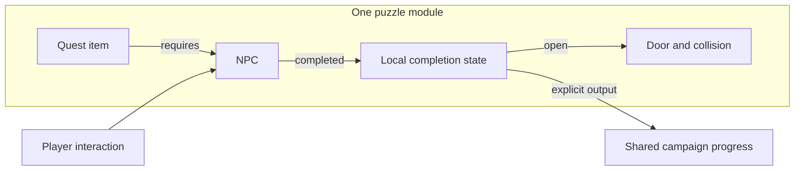
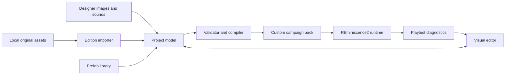

<!-- SPDX-License-Identifier: GPL-3.0-or-later -->
# Visual level editor: feasibility and design

Implementation update (1.44): all seven native levels now expose typed puzzle
connections, behavior isolation, complete-bundle relocation/copy, live message
and actor monitoring, and frame stepping. Original actor/resource provenance is
preserved. See [implemented native modules and boundaries](NATIVE_CAMPAIGN_MODULES.md).
State/dialogue/actor node graphs and their simulator remain available. Cross-level
native prefab imports, arbitrary mixed enemy palettes and persistent custom graph
saves remain design work.

Status: **broader design proposal; first playable slice implemented in 1.36**.
See the [current editor guide](LEVEL_EDITOR.md) and
[implemented schema](formats/CUSTOM_PROJECTS.md). Features below that are absent
from that guide remain proposals, including native event-graph conversion and the
complete prefab catalog. Native campaign editing has been implemented since 1.39. The first slice runs a disposable scene inside the
editor, rather than launching a separate process for each playtest.

Original study: engine 1.35
and repository commit `4d28251` on 2026-10-26. Original Amiga, GOG DOS and Sega CD
data were inspected locally; no Macintosh game assets were available.

## Recommendation

Build a separate desktop **REminiscence2 Editor**, sharing resource decoders,
simulation and rendering code with the game. Give designers a room canvas,
three visual layers, a separate collision/ledge overlay, a room connection map,
and a palette of reusable objects. Launch playtests in the real engine.

Use a new, versioned project format with stable object identifiers. Import
original levels as local working copies; never edit the user's installed game
files. A project may depend on an original asset edition or supply its own art.
The first custom-level profile should retain Flashback's movement and room
rules. Arbitrary polygon physics and unlimited actors are separate engine work.

The biggest task is making object behavior portable. Drawing the editor is
straightforward compared with safely extracting an enemy, its animation,
projectiles, messages, graphics and palette dependencies from a particular level.

## The designer's workspace

Conceptual layout, not a screenshot of a working application:

```text
 File  Edit  View       [Room] [World] [Object]       Validate   Play
 ┌─────────────────┬─────────────────────────────┬─────────────────────┐
 │ OBJECT PALETTE  │ ROOM CANVAS                 │ INSPECTOR           │
 │ Search         │                             │ Selected: Door      │
 │ Player start   │ Artwork + selected overlays │ Initial state       │
 │ Enemies        │                             │ Activation input    │
 │ Doors / lifts  │ Move, stamp, paint, connect  │ Sound / animation   │
 │ Switches       │                             │ Collision footprint │
 │ Pickups        │ Adjacent-room ghost preview │ Connections         │
 │ Animated props │                             │ Instance overrides  │
 ├────────────────┼─────────────────────────────┼─────────────────────┤
 │ LAYERS         │ ROOM STRIP / WORLD OVERVIEW │ VALIDATION          │
 │ Front          │                             │ Click to locate     │
 │ Playfield      │                             │ warnings and errors │
 │ Back           │                             │                     │
 │ Collision      │                             │                     │
 │ Ledges         │                             │                     │
 │ Links/triggers │                             │                     │
 └────────────────┴─────────────────────────────┴─────────────────────┘
```

Palette entries have animated thumbnails, useful names and edition requirements.
Drag an entry onto the canvas, or select it and click to place repeatedly.
Selection shows the pivot, occupied space, facing, activation bounds and links.
An inspector exposes meaningful settings such as health, initial door state and
lift stops; raw opcode numbers belong only in an advanced diagnostic view.

Provide undo/redo for every edit, multi-selection, duplication, alignment,
snapping, layer locks, visibility and a clean preview. Dragging a selection is
one undo operation. Duplicating a group remaps internal connections while
showing any connections that still point outside that group.

### Three visual layers, independent gameplay overlays

The requested layer model is the authoring contract:

| Layer | Contents | Behavior |
| --- | --- | --- |
| **Back** | Room background, distant scenery, rear decorations | Drawn behind all playfield actors; opaque room base plus optional transparent elements |
| **Playfield** | Conrad, enemies, pickups, doors, lifts, animated objects and decorations at their depth | Explicit stable draw order within this layer; movable objects retain their anchors |
| **Front** | Railings, foliage, pillars, door frames and other foreground art | Alpha-composited over playfield actors so Conrad can pass behind it |
| **Collision overlay** | Walkable surfaces, blocking regions and supported special collision patterns | Editor/debug display only; independent of image pixels |
| **Ledge overlay** | Grab/climb markers, facing and clearance guides | Editor/debug display only; compiled to supported movement/collision rules |
| **Logic overlay** | Room exits, trigger bounds and object connections | Editor/debug display only; no ordinary in-game artwork |

Composite Back → Playfield → Front → game HUD. Editor overlays are drawn above
that result only while editing or debugging. A Front image does not become a
wall; a Back image can have a wall defined in the collision overlay. A door can
contain a moving playfield panel, a front frame and a changing collision region
inside one reusable object.

Import PNG images with transparency, or an opaque image converted into the
project's image format. Support independent images and crops from a larger
sheet, preserving the source. An import preview sets logical size, position,
pivot and layer; aspect changes are explicit. Replacing artwork preserves
collision and ledge data unless the designer deliberately transforms them too.
Scaling an existing object must show its collision consequences before applying.

Start with 256×224 logical room artwork. Higher-resolution sources can map to
that same logical space; the first playable slice may downsample explicitly.
Preserving extra image detail at runtime requires a separate render-resolution
implementation. Importing a 4K picture does not make the gameplay area wider.

## What the engine actually provides

The detailed legacy layouts are in [Game data and graphics](formats/GAME_DATA.md).
The following findings determine the editor design:

| Area | Current implementation | Consequence |
| --- | --- | --- |
| Rooms | Four directional neighbor tables, 64 room slots per loaded level | Store an explicit graph; canvas arrangement alone cannot define transitions |
| Collision | CT contains 16×7 bytes per room, after 256 topology bytes | A compatibility compiler must preserve these rules |
| Collision coordinates | X uses `(x + 8) >> 4`; Y queries use `(y / 36) & ~1` plus opcode-specific offsets | This is not a simple square-tile or pixel-accurate physics grid |
| Screen boundaries | Horizontal movement uses 256 pixels; vertical room transfers use 216, although art is 224 pixels high | Show the transition seam and overlap explicitly; centralize coordinate conversion |
| Actors | Up to 256 `InitPGE` records; runtime tables also contain 256 entries | Count hidden actors and helpers, not just visible objects |
| Behavior | OBJ/OBC nodes with condition/action opcodes and state changes | Portable prefabs need behavior-aware references and validation |
| Animation | ANI includes sprite frames, sound and movement deltas | Preserve root motion, timing, pivots and firing origins |
| Sprite selection | Enemy graphics/palettes depend on level-specific tables and shared loaded banks | Cross-level enemy placement needs explicit sprite/palette ownership |
| Rendering | Indexed front/back buffers and palette conversion; RGB output exists | Arbitrary PNG backgrounds need a new compositing path |
| Campaign | Seven original level definitions, edition-specific loads and original story hooks | Custom campaigns need their own identity and loading path |
| Build | Reusable `reminiscence2_engine` library, SDL2, Dear ImGui | A separate native editor can share tested engine components |

### Local asset probe

A temporary headless C++ probe linked the existing engine library and called
`initCutsceneResources()` and `loadLevelData()` for all seven levels in all three
available editions. All **21 loads completed**. It counted loaded actor records
and actors whose initial room is outside the 0–63 visible-room range:

| Level | Actor records | Initially outside visible rooms |
| --- | ---: | ---: |
| 1 | 107 | 14 |
| 2 | 256 | 48 |
| 3 | 176 | 19 |
| 4 | 190 | 28 |
| 5 | 90 | 19 |
| 6 | 109 | 24 |
| 7 | 169 | 42 |

These counts matched across the three tested editions. They do not establish
identical scripts or enemies: the probe also found edition differences in actor
class counts. Nonvisible records include dormant effects, inventory and other
state; this table does not classify every record as a particular helper type.
Level 2 already reaches the physical actor-array capacity before any additions.

Loaded CT values were 0, 1 and 2 in these fixtures. Their meanings still depend
on the consuming opcode. Some raw room links are asymmetric, and map-presence
checks differ between MAP and banked LEV formats. Neither raw connectivity nor
`hasLevelMap()` alone proves that a room is an ordinary reachable gameplay room.
Import must distinguish normal rooms, absent artwork and off-screen holding
state. This was a load/data study, not a full playthrough or editor proof.

## Collision and ledge editing

Show designer intent separately from compiled engine data. Paint collision with
brush/rectangle/erase tools over the art. Place ledge handles with direction,
landing surface and climb clearance. The editor can display a ghost Conrad at
the resulting stand, hang and climb positions.

For the first movement profile, offer **verified floor/wall/ledge stamps** that
produce tested CT patterns. Ledge handles are authoring metadata, not a new
native ledge subsystem: compilation derives the required neighboring cells.
Warn about incompatible overlapping stamps and unreachable grabs. Preserve
unknown imported CT patterns as raw data with a visible diagnostic rather than
guessing their meaning or silently rewriting them.

Keep three debug views distinct: scenery collision queries, actor collision
buckets, and rendered sprite bounds. `col_getGridPos()` uses a separate coarse
actor grid; it is not the 16×7 scenery grid. The visual silhouette is not a
reliable collision body, and sprite transparency is not collision data.

Doors/lifts own dynamic collision changes through their prefab contract. Reject
unsupported spans and out-of-room writes before play. The current collision
mutation path saves a small fixed-size span, so a designer cannot safely draw
an arbitrarily wide moving wall and expect it to work unchanged.

Polygons or image-assisted tracing can be later authoring conveniences. They
must preview the quantized result. Truly arbitrary slopes, polygon contact and
pixel-precise ledges would require new movement behavior and cannot be promised
by adding editor drawing tools alone.

## Room connections and campaign flow

The World tab shows room thumbnails with left/right/up/down ports. Dragging
between ports creates a link. Offer an explicit reciprocal-link operation;
preserve intentional one-way links. Keep layout coordinates separate from the
graph so imported non-spatial arrangements remain representable.

For edge transitions, preview both rooms at the actual boundary, including the
216-pixel vertical stride. Check floor alignment, collision probes and safe
arrival positions. The initial compatibility profile supports the engine's
single neighbor per direction. Door portals, multiple exits on one edge and
explicit destination spawn markers require a transition component and belong
after the basic edge-link slice.

Campaign exits refer to stable chapter and spawn IDs. Original level numbers,
metro special cases, intro movies, journal unlocks and ending behavior must not
activate just because a custom room happens to reuse an original number.

## Self-contained objects: prefabs

A prefab is a reusable definition with private implementation details and a
small public interface. It may contain several child objects. Asset data is
shared by reference; mutable state belongs to each placed instance.

| Prefab part | Examples |
| --- | --- |
| Appearance | Sprite family, per-frame pivots, palette, Back/Playfield/Front parts |
| Animation | Named states, frame timing, root movement, sound events |
| Collision | Static footprint, dynamic blocking state, interaction bounds |
| Behavior | Vetted original behavior adapter or a named engine component |
| Parameters | Facing, health, initial state, allowed patrol distance, lift stops |
| Inputs/outputs | `Open`, `Close`, `Activated`, `Defeated`, `Arrived` |
| Private children | Projectile, muzzle effect, hidden controller, linked mechanism |
| State | Serializable local state and stable child identifiers |
| Requirements | Edition/revision dependencies, runtime capabilities, actor budget |

Example: place a switch and a door, then draw **Switch.Activated → Door.Open**.
The designer does not choose a PGE index or know the door's animation-state
number. Duplicating the pair creates independent instances with the internal
wire reconnected to the duplicate door. A separate front-frame image can belong
to the door prefab while the moving panel stays in Playfield.

The first palette should include a player-start bundle, an animated prop, one
pickup, one switch, one door and one enemy archetype. Then expand to lifts,
hazards, checkpoints, triggers, NPCs, dialogue, exits and the other enemy types.
Do not label an imported object reusable until it passes duplication and
cross-room tests.

### The dependency problem

`InitPGE::data[4]` is context-dependent. Message opcodes use these fields as
actor references; other behaviors use them as counters or other values. Some
opcode arguments directly reference actors. Relocating every small integer as
an actor ID would corrupt levels.

Define a reviewed opcode/behavior schema marking actor references, room IDs,
state IDs, scalar parameters and external services. Extract the dependency
closure of a known object using that schema. Classify dependencies as private
children, shared resources, or explicit external ports/services. Cyclic actor
links are legal; walk with a visited set. Unknown or computed references block
automatic prefab extraction and produce an actionable report.

The compiler assigns runtime slots only after expansion and rewrites typed
references. Preserve shared behavior-node aliases unless instance-specific
patching requires a copy. Preserve stable update order and test it; changes in
actor allocation can change message ordering. Actor zero is Conrad in legacy
code; `0xFE`/`0xFF` holding-room states and `0xFF` sentinels must be handled by
field semantics, never treated as ordinary room/actor references indiscriminately.

A new friendly object library should combine certified original behavior
adapters with small new components where portability is otherwise impractical.
Start with named components, parameters and event connections. A full visual
state-machine editor is a later feature, after animation and collision behavior
can be inspected and validated reliably. Avoid making arbitrary scripts or
native plugins a prerequisite for ordinary level design.

## Native puzzles as connected modules

**Design contract from 1.41; typed native modules and bounded relocation are implemented in 1.44.**
The [current guide](NATIVE_CAMPAIGN_MODULES.md) identifies the supported subset
and remaining cross-level/resource limits.
Treat each complete connected puzzle as the reusable module. A door alone is a
part; its switch, key/item check, controller, timers, hidden helpers and effects
belong to that same module when they share local puzzle ownership. A puzzle may
span rooms. An NPC retrieval chain can own the NPC, quest item, completion flag
and unlocked door. Mission chains can own their computers and local objectives.



Module ownership differs from mere reachability in a script-reference graph.
Conrad, common inventory services and campaign progression are shared boundaries,
otherwise following every reference would merge unrelated puzzles into a single
component. Two puzzles communicate through typed external ports. Shared actors
are not copied into each puzzle; ambiguous ownership stays visible for review.

The native importer must decode reference semantics from the opcode and operand
position. `InitPGE::data[]` mixes IDs and numbers; an integer in actor range is not
proof of a connection. Preserve original actor IDs, behavior tables and every
unclassified value while mapping candidate groups. Distinguish actor ownership,
message delivery, inventory requirements, spatial collision regions and state
transitions. Grouping by room, proximity or raw numeric equality is insufficient.

The intended GUI selects an entire puzzle from the palette, highlights its local
parts and links, and shows badges for parts in other rooms. Expanding its graph
reveals the nodes, local state, resource dependencies and external ports. A live
monitor should show executed transitions and messages with their source, target,
frame and values. Initial-state artwork alone must not be presented as live state.

Implementation sequence for original puzzles:

1. Decode typed dependencies and expose a read-only graph with original IDs and
   explicit unknown links. Review puzzle ownership rather than inventing it.
2. Add bounded runtime tracing and compare behavior against the untouched
   campaign. Playback/monitoring must not change simulation order or results.
3. Enable validated parameter and connection overrides on a copied puzzle graph.
   Keep unknown transitions unchanged. Apply changes at safe boundaries or restart
   when state migration cannot be proved; do not rewrite original asset files.
4. Add reviewed whole-puzzle prefabs to the palette. Allocate new actor/helper IDs,
   remap internal references, preserve external ports and isolate local state.
   Reject unresolved shared dependencies or capacity/resource-bank conflicts.

Acceptance requires the original puzzle to behave identically before editing,
two copies to operate independently, cross-room links and invisible helpers to
survive export/reload, and monitored play to match unmonitored simulation. There
must be no accidental cross-opening doors, shared quest counters, detached items,
duplicate player objects or lost campaign dependencies. Existing custom puzzle
modules already provide the authoring unit; the native bridge must meet these
requirements before claiming complete campaign conversion.

## Architecture and implementation boundaries



Proposed modules, not existing files:

| Module | Responsibility |
| --- | --- |
| `editor/model` | Project, rooms, layers, prefab definitions/instances and typed connections |
| `editor/commands` | Undoable transactions, selection changes, recovery snapshots |
| `content/import` | Edition-specific import using the existing bounded decoders |
| `content/schema` | Versioned data schemas, migrations, parameter and reference types |
| `content/compiler` | Prefab expansion, slot allocation, collision compilation, dependency resolution |
| `content/validation` | The same checks used by UI, command-line validation and runtime loading |
| `editor/ui` | Canvas, palette, inspector, world graph, animation preview and diagnostics |
| `runtime/custom_campaign` | Explicit custom loader, spawn selection and campaign identity |
| `runtime/composition` | Back/Playfield/Front compositing with independent actor palettes and coverage |

Start with resizable panes using the bundled SDL2/ImGui setup. The vendored
ImGui 1.91.9b header does not expose DockSpace; a full docking workspace requires
an intentional dependency change. Desktop keyboard/mouse editing targets macOS,
Windows and Linux. Playing exported packs on Deck/Quest is a separate validation
target, not a promise of a comfortable headset editor.

### Rendering changes are real engine work

`Video` currently composites indexed pixels into its frame buffers. Loading a
PNG as an SDL texture behind that final opaque frame will not produce the
requested three layers. Add an explicit custom-room compositor with coverage
or alpha for actors and foregrounds. Convert palette-based sprites with their
own palette context, preserving original pivots and transparent pixels.

`SystemStub::copyRectRgb24()` provides an output route, not the whole solution.
Masks, foreground priority, damage regions, fades, screenshots and widescreen
side scenery also need to use the custom composition path. Avoid deriving actor
transparency by comparing final-frame pixels with the background: an actor can
legitimately have the same color. Reuse decoding and original rendering as the
reference while exposing explicit sprite draw data/coverage for custom rooms.

Mixed enemy families need independent resolved graphics and palette ownership;
the current shared monster bank and palette slot are not a general sprite
catalog. Until that refactor is proven, the compiler should reject unsupported
family combinations instead of drawing the wrong enemy or recoloring the room.

### Playtesting and saves

Initially compile a snapshot and launch a separate game process with that pack
and an isolated test-save directory. The game has globals, mutable resource
banks and audio ownership; embedding a second live `Game` in the editor process
is not automatically safe. Share the library and data contracts without requiring
multiple simultaneous worlds in one process.

Offer **Play from campaign start**, **Play this room**, and **Play from marker**.
Use a complete player prefab with weapon/inventory dependencies and a validated
spawn pose; changing just Conrad's X/Y is insufficient. Later add pause, single
tick, restart-room, state inspection and deterministic input recording. Editing
art may hot-reload; topology/behavior changes should restart from a clean
snapshot until state migration is explicitly supported.

Custom saves need campaign ID, content fingerprint, runtime/schema version and
stable prefab-instance state, including helper actors and changed collision.
Editor playtests must not overwrite campaign saves or unlock original journal
entries. Show incompatible-content errors explicitly rather than applying an
old save to newly allocated actors. Rewind must capture the same custom state.

### Project and export format

Use readable versioned JSON plus relative asset references. Suggested layout:

```text
my-campaign/
  project.r2project.json
  rooms/hangar.room.json
  rooms/lift-shaft.room.json
  prefabs/maintenance-door.prefab.json
  art/hangar-back.png
  art/hangar-front.png
  audio/door-close.ogg
  .cache/                         # local previews/decoded assets; not exported
```

The project manifest records stable campaign ID, schema version, movement
profile, entry room, asset dependencies and prefab versions. Room files contain
visual layers, collision/ledge data, instances and explicit links. Machine-local
asset paths belong in local settings, never in a shareable project.

For example, an instance conceptually refers to a definition and overrides only
its parameters:

```json
{
  "id": "door-hangar",
  "prefab": "maintenance-door@1",
  "room": "hangar",
  "position": [160, 144],
  "parameters": {"initialState": "closed"}
}
```

This is an illustrative shape, not a finalized or supported schema. Production
IDs should be stable UUIDs with separate editable names.

Export a bounded, validated pack with a manifest, content hashes and only the
required custom resources. Asset-backed packs reference an edition and resource
revision; they do not copy an entire commercial installation. A package should
report which assets are supplied and which the player must provide. Original
imports can remain local working copies. Independently authored examples can
ship with the editor; record their licenses and provenance.

## Build versus adopt

| Approach | Useful existing capabilities | Work still specific to REminiscence2 |
| --- | --- | --- |
| **Dedicated SDL2/ImGui editor** | Existing build, renderer integration and engine library | Canvas tools, undo/redo, import UI and all content contracts |
| **Tiled plus a bridge** | Image/object layers, object templates, custom properties and scripting extensions | CT/ledge semantics, helper bundles, behavior ports, palette preview, engine playtests |
| **LDtk plus a bridge** | Entity definitions with typed fields, level backgrounds, world layout and JSON | Engine-specific collision mapping, prefab behavior/dependencies and accurate simulation preview |

Tiled is the fastest plausible route to a generic map-authoring front end. It
would be a reasonable choice if the immediate goal were image placement plus
engine-specific property forms. The requested reusable animated objects,
correct ledge previews and integrated behavior diagnostics justify a dedicated
editor as the recommended destination. These are engineering judgments, not
measured development-time comparisons.

Keep the project model and compiler independent of the UI so a later Tiled/LDtk
importer is possible. Do not build and maintain three front ends initially.
Python remains useful for asset preparation and batch conversion; gameplay and
collision preview should use the actual C++ engine.

Official references consulted:

- [Tiled templates](https://doc.mapeditor.org/en/stable/manual/using-templates/)
  describe reusable object definitions and per-instance property overrides.
- [Tiled layers](https://doc.mapeditor.org/en/stable/manual/layers/) document
  image, object and tile layers.
- [Tiled scripting](https://doc.mapeditor.org/en/stable/manual/scripting/)
  documents extensions to the editor.
- [LDtk entities](https://ldtk.io/docs/general/editor-components/entities/) and
  [JSON reference](https://ldtk.io/json/) describe typed fields, background images
  and level references.
- [Dear ImGui](https://github.com/ocornut/imgui) documents tooling integration,
  platform backends and docking availability. Its accessibility and text-shaping
  limitations are a tradeoff for a public editor; provide keyboard navigation,
  adjustable UI scale and evaluate native dialogs where useful.

## Validation before accepting custom content

Existing decoders are useful, but structural decoding is not semantic safety.
For example, `pge_loadForCurrentLevel()` searches for an initial state and
`pge_execute()` indexes the opcode table with assumptions appropriate to known
assets. Add bounds checks and semantic validation before treating arbitrary
custom content as playable input.

Reject invalid initial states, missing animation/sprite data, unknown opcodes,
unresolved typed references, illegal room/sentinel use, overflowed collision
spans and insufficient actor/helper capacity. Validate all difficulty variants.
The legacy ceiling is 64 rooms, 256 actor array entries and 255 behavior nodes;
usable slots also depend on reserved identities and sentinel restrictions.
Dynamic collision and message pools need their own budgets and exhaustion
behavior. Raising one array size does not remove these limits.

Validate imported image sizes, decompression bounds, paths and archive entries.
Bound event processing and diagnose immediate signal loops. Keep ordinary
graph loops legal. Use atomic project saves and schema-versioned recovery.

Prioritize tests that exercise behavior:

- Two independently placed switch/door pairs do not open each other's doors.
- Duplicate enemies have separate projectiles, health, messages and inventory.
- A test actor crosses a room seam both ways, climbs a ledge and returns.
- A foreground rail hides only the covered actor pixels; it adds no collision.
- Changing background art leaves the same recorded gameplay state.
- Door/lift collision survives save/load and rewind.
- Identical compiled content and inputs produce identical state traces.
- Removing a dependency produces a clear pre-play error, not a crash.
- Original Amiga/DOS/Sega CD regression fixtures continue to pass.

## Delivery sequence and proof points

1. **Read-only level inspector.** Browse rooms, draw real sprites and collision
   probes, show room links and actor dependencies. Import all three available
   editions; retain unknown data. Prove that previews match engine output before
   enabling editing. Add a useful report for missing/unverified Mac resources.
2. **First playable custom scene.** Two rooms with imported Back and Front PNGs,
   a Playfield player bundle, independently authored collision and ledges, one
   linked screen edge, undo/redo, project save/reopen and real-engine playtest.
   Verify walking behind foreground art and climbing a ledge. This needs the
   custom loader/compositor and foundational validation, not just editor UI.
3. **Reusable palette.** Add one animated prop, pickup, switch, door and enemy
   with their helpers. Wire the switch to the door, duplicate the pair, and test
   independence. Prove cross-room placement and explicit edition dependencies.
4. **Campaigns and export.** Chapter exits, checkpoints, custom-save isolation,
   pack installation, dependency reporting and original-campaign regression.
   Validate the same exported scene on each supported game runtime target.
5. **Expand authoring.** Lifts, other enemy families, NPCs, dialogue, original
   story/journal entries, visual behavior graphs, animated foregrounds and
   higher-resolution compositing. Raise runtime limits only with a dedicated
   migration and regression plan.

The first milestone worth calling a usable editor is **step 2**, followed by
step 3 for the requested modular palette. A useful end-to-end demonstration is:
import two room images, paint a floor, mark a ledge, connect the rooms, place a
switch/door/enemy, press Play, and complete the encounter with original Conrad
movement. Full arbitrary-object extraction is a later coverage goal, not a
condition for proving that workflow.

## Source navigation

- [CMakeLists.txt](../CMakeLists.txt): shared engine and UI libraries.
- [intern.h](../intern.h): `InitPGE`, `LivePGE`, `Object`, collision structures.
- [resource.h](../resource.h), [resource.cpp](../resource.cpp),
  [resource_segacd.cpp](../resource_segacd.cpp): resource ownership and loaders.
- [object_data.cpp](../object_data.cpp): bounded OBJ/OBC structure decoding.
- [collision.cpp](../collision.cpp): room-grid and actor collision queries.
- [piege.cpp](../piege.cpp): behavior, animation motion, links and collision mutation.
- [staticres.cpp](../staticres.cpp): opcode table and original level definitions.
- [game.cpp](../game.cpp): level loads, monster banks, room transfers and saves.
- [video.cpp](../video.cpp), [systemstub_sdl.cpp](../systemstub_sdl.cpp): composition/output.
- [tests/headless_system.h](../tests/headless_system.h): deterministic test platform.
- [Asset reference](ASSETS.md), [format reference](formats/README.md): edition boundaries.
