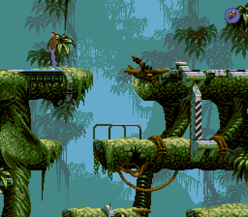
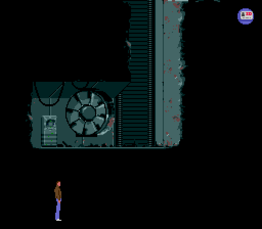
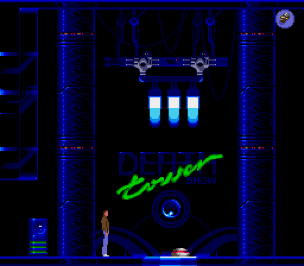
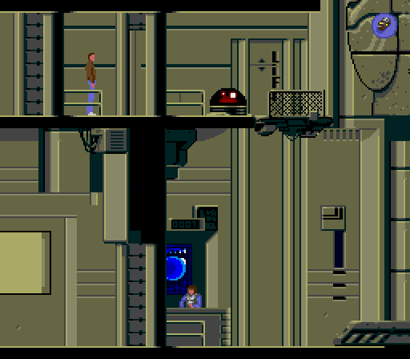
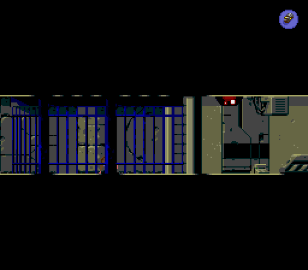
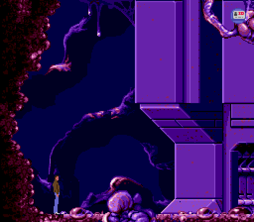
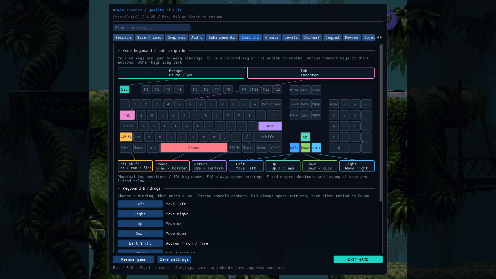

<!-- SPDX-License-Identifier: GPL-3.0-or-later -->
# REminiscence2 1.80 — player, visual editor and Systems Lab

This preview brings the visual campaign editor and the public **Conrad Systems
Lab** into the desktop downloads, alongside the Flashback player and its QoL
tools. It is a community homage to **Delphine Software**, the original authors,
and the people who preserved and maintained this game.

## New since the 1.35 release

- **Separate visual editor:** four workspaces for level artwork/collision,
  placing reusable modules, editing node graphs, and connecting levels into
  campaigns. Import/slice larger artwork, use Back/Playfield/Front layers,
  paint collisions and ledges, and define screen transitions.
- **Connected puzzles:** dialogue, items, doors, actors, timers, state machines,
  animation/audio and other actions form reusable modules. Animated signal
  traces, node help, comments, validation links, graph navigation and simulation
  controls help explain how the puzzle works.
- **Study the original campaign:** import the seven native levels with their
  actors and rule dependencies, inspect connected puzzles, and edit supported
  fields. Compatible native changes can apply during play; actor-slot changes
  and incompatible edits require restarting. Original resource limits remain,
  including New Washington's full actor allocation. Copies stay within the
  same level and asset edition. See the
  [native editing limits](https://github.com/b0realis/REminiscence2/blob/v1.80/docs/NATIVE_CAMPAIGN_MODULES.md).
- **Play from the room you are editing:** session-only test positions and graph
  node selection make room/puzzle checks quicker. Custom scenes use Stop → edit
  → Play. Native and whole-campaign playtests use the separate player.
- **Campaign authoring:** connect levels and branches, insert supported movies,
  and make illustrated text screens with placement and typewriter effects.
  Campaign progress preserves the relevant actor, puzzle and dialogue state.
- **Conrad Systems Lab:** five public rooms demonstrate movement, droid repair,
  computer conversations, an interlocked airlock, lighting/fan switches and a
  moving shooting target. Controlled sparks, mist and other particles follow
  the experiments' states. Lore-inspired fan-written dialogue replaces simple
  task prompts. The editable project, media and graphs are included; playing
  still needs your own compatible Flashback assets.
- **Editor and authored-level fixes:** undesigned screen exits are sealed;
  Esc/F10 opens QoL in the standalone campaign player. Native-style text,
  graph editing, input, live-state validation and save handling have received
  focused fixes. Windows editor compilation and the node-dragging sanitizer
  failure are fixed in the included 1.79 patch.
- **Build it yourself:** a new
  [standalone guide](https://github.com/b0realis/REminiscence2/blob/v1.80/docs/BUILDING.md)
  covers Windows, Linux and both Mac architectures, complete builds, player-only
  builds, editor-only builds, tests, optional dependencies and troubleshooting.
- **Desktop packaging:** ZIP/tar downloads contain the player and separate
  editor executables, editor guide and public starter projects. Both binaries'
  runtime dependencies and the packaged examples are checked. Private authored
  campaigns and original game data remain excluded.

## Included player features from earlier releases

- Live QoL menu with **Esc, F10 or controller Start**, desktop/native-resolution
  layouts, saves, levels, cheats, journal, audio, controls and graphics settings.
- **Ctrl+S / Ctrl+L** quick-save/load, rotating autosaves, save previews,
  checkpoint recovery, optional rewind and optional automatic resume.
- Keyboard remapping with a graphical keyboard preview, gamepad profiles,
  disconnect pause and optional input/accessibility assists.
- Windowed, borderless and fullscreen presentation; resolution selection,
  integer pixel scaling, Point/Linear/ScaleNx and xBRZ 2×–6×; one-click Classic
  pixels, Widescreen scenery and Smooth widescreen presets. Extra side scenery
  does not enlarge the playable area.
- Amiga, DOS/GOG and US Sega CD asset discovery, edition selection and optional
  independent soundtracks. Sega CD movies, voices and music use original data.
  Inherited Macintosh support remains, with real-data validation still pending.
- Skippable opening/cutscene sequences, mouse/wheel title navigation, optional
  undershirt and pistol cosmetics, fading journal notices and top-edge save
  notifications. Original gameplay remains the default.
- Python tools for Amiga WHDLoad preparation, Sega CD CUE/BIN extraction,
  cutscene browsing/playback and compact private asset packages.
- Offline **Real-CUGAN Pro 3× / denoise 3** movie upscaling, original frame
  timing/audio, and optional tracked sign repair. The scripts and guide are in
  `tools/`; model binaries, original footage and restored videos stay separate.
  The game still plays original MCD movies, not the generated MP4s.

## Gallery

Earlier project captures of six original campaign levels and the QoL keyboard.
These illustrate retained features; their capture versions predate this release.
Original Flashback artwork belongs to its respective rights holders.

| Jungle | New Washington | Death Tower |
| :---: | :---: | :---: |
|  |  |  |
| Earth | Paradise | Alien world |
|  |  |  |

## Downloads and first launch

| System | Download |
| --- | --- |
| Windows x64 | `win64.zip` — player and editor `.exe` files |
| Linux x64 | `linux64.tar.gz` — `play.sh` and the editor executable |
| Steam Deck | `steamdeck.tar.gz` — add `play.sh` as a Non-Steam Game |
| Mac Apple Silicon | `macos-arm64.dmg` for the player; `.zip` for player and editor |
| Intel Mac | `macos-x86_64.dmg` for the player; `.zip` for player and editor |
| Quest arm64 | Signed APK, or bundle ZIP with the Linux/ADB deployment helper |
| Source | `source.tar.gz` — tagged source plus pinned SDL2/zlib sources |

Put your prepared editions into the precreated `assets` folder, each in its own
subfolder. Mac DMGs can use `~/Library/Application Support/REminiscence2/assets`.
Keep the editor beside the player for external playtests. Open the editor's
**Game assets…** picker to select your data. Copy a public example directory to
a writable working folder before changing it.

No playable original game data, supplied scans, private story campaigns, saves,
ROMs, soundfonts or signing keys are distributed. **SHA256SUMS** covers the ten
package/source files. The binaries are built and checked from the same commit
as this tag; the publisher requires both Build and test and Release packages
workflows to succeed for that commit.

## Preview limitations

Mac apps are ad-hoc signed and not notarized. Quest is an Android flat-panel
player; the desktop editor is not included in its APK. Physical Quest/Steam Deck
testing, complete human playthroughs, additional Sega CD pressings and real
Macintosh asset validation remain outstanding. Automated CI is not a substitute
for those device/gameplay checks. See the
[editor guide](https://github.com/b0realis/REminiscence2/blob/v1.80/editor/README.md)
and [validation records](https://github.com/b0realis/REminiscence2/blob/v1.80/docs/VALIDATION.md)
for the supported workflows and their limits.
